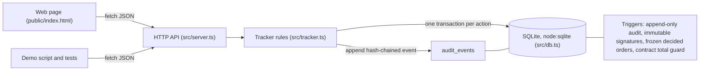
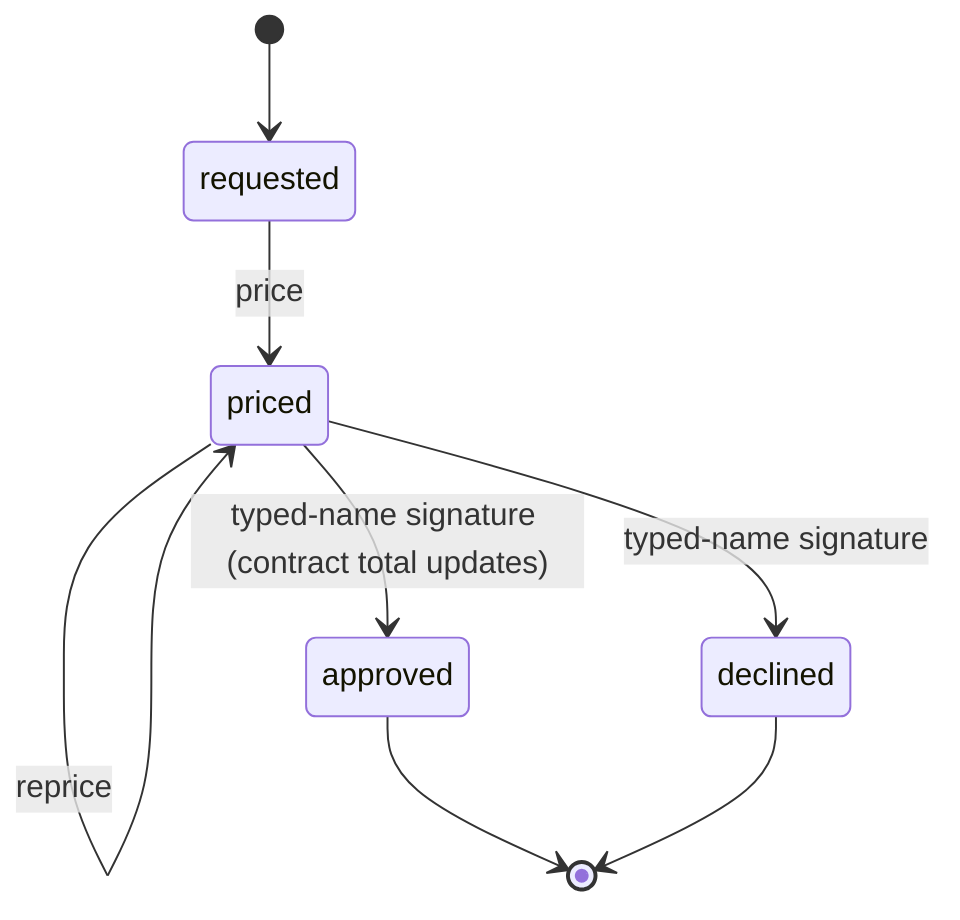

# change-order-tracker

Mid-job changes get agreed verbally, priced later, and argued about at the final invoice.
This tracker makes every change a priced, customer-signed record, and the contract total moves only when the customer approves.

## What it does

- **Request**: anyone on the job logs a change against a project. It gets the next CO number.
- **Pricing**: the office adds line items (integer cents, credits allowed). It can be repriced until the customer decides.
- **Customer approval**: the customer types their full name. It must match the name on the project, and the request must carry the total the customer was shown, so a price changed in the meantime cannot be approved by accident. The signature record stores the typed name, a server timestamp, the amount, a SHA-256 hash of the exact terms signed, the IP and the user agent.
- **Contract total**: changes in one code path only (approval), in the same transaction as the signature.
- **Immutable audit trail**: every step appends an event that is hash-chained to the one before it.

The rules are enforced in the database, not just in the API. SQLite triggers reject:

| Attempt | Result |
| --- | --- |
| Update or delete an audit event | blocked |
| Update or delete a signature | blocked |
| Edit a change order or its line items after approve or decline | blocked |
| Set a contract total that is not base + approved change orders | blocked |

If someone with raw file access drops the triggers and edits history anyway, `GET /api/audit/verify` recomputes the hash chain and reports the first altered event.

## Architecture





No runtime dependencies: Node's built-in `http`, `sqlite` and `crypto` modules, with TypeScript run directly by Node (type stripping). `typescript` and `@types/node` are dev dependencies used only for type checking.

## Run it

Needs Node 24 or newer.

```
npm install
npm start
```

Open http://localhost:3000. The store is in memory and seeded with two fake projects. To persist, copy `.env.example` values into your shell, for example `DB_PATH=./data.db npm start`.

### API

| Method and path | Purpose |
| --- | --- |
| `GET /api/projects` | list projects |
| `GET /api/projects/:id` | project, totals and change orders |
| `POST /api/projects/:id/change-orders` | request a change: `title`, `description`, `requestedBy` |
| `GET /api/change-orders/:id` | one change order with line items and signature |
| `POST /api/change-orders/:id/price` | `pricedBy`, `lineItems: [{description, quantity, unitPriceCents}]` |
| `POST /api/change-orders/:id/approve` | `typedName`, `expectedTotalCents` |
| `POST /api/change-orders/:id/decline` | `typedName`, optional `reason` |
| `GET /api/audit?projectId=` | audit events |
| `GET /api/audit/verify` | recompute the hash chain |

## Tests

```
npm test
```

13 tests using the built-in Node test runner: the lifecycle rules, validation, the database triggers against direct SQL tampering, hash chain tamper detection, and the HTTP API end to end on a random local port. `npm run typecheck` runs the TypeScript compiler in check-only mode. CI (`.github/workflows/ci.yml`) runs typecheck, tests and the demo.

## Demo

```
npm run demo
```

Runs offline. It starts the real API on a random local port with an in-memory store and a fixed clock, then walks one fake project through: request, pricing, a signature attempt under the wrong name, a reprice followed by an attempt to approve the stale price, a valid approval, a declined credit, tampering attempts through the API and raw SQL, and the audit trail. Captured output is in [demo/output.txt](demo/output.txt). Excerpt:

```
5. Customer approves the current price by typing their name
   status=approved
   signature: typed name "Alex Sample", signed at 2030-03-04T14:07:30.000Z, amount $610.00
   contract total after approval: $19,110.00 (base $18,500.00, approved changes $610.00, awaiting approval $0.00)

7. Trying to change an approved change order
   API: HTTP 409: change order is already approved and cannot be repriced
   raw SQL "UPDATE signatures SET typed_name = 'Forged Name'" -> blocked: signature records are immutable
```

## Where this pattern runs

This is a clean-room, small-scale version of a pattern drawn from systems that run two small service companies day to day: scope changes are captured as records, priced before work proceeds, approved by the customer in writing, and the contract value follows the approvals rather than anyone's memory. All data here is invented.

## Limitations

- No authentication or roles. `requestedBy` and `pricedBy` are free text, and anyone who can reach the API can call any endpoint. A real deployment needs logins for staff and a per-customer approval link.
- A typed name is evidence of intent, not identity proof. There is no email or SMS verification of the signer, and this has not been reviewed against any e-signature law.
- Tamper evidence has limits. Triggers stop edits through SQL, and the hash chain exposes edits to history, but someone with full control of the database file could rewrite the whole chain. Anchoring the latest hash somewhere external would close that gap.
- Approved change orders cannot be voided or reversed. A correction has to be a new change order (for example a credit).
- Quantities are whole numbers and there is no tax, markup or multi-currency handling.
- Single process, synchronous SQLite. Fine for a small company, not built for concurrent writers across machines.
- The web page is a plain functional page. Its script is syntax checked and the API it calls is tested, but there are no automated browser tests.
- `node:sqlite` may print an experimental warning on some Node versions.

License: MIT, see the LICENSE file.
