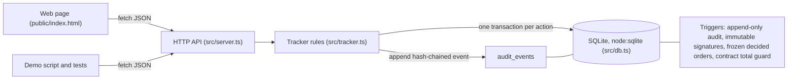
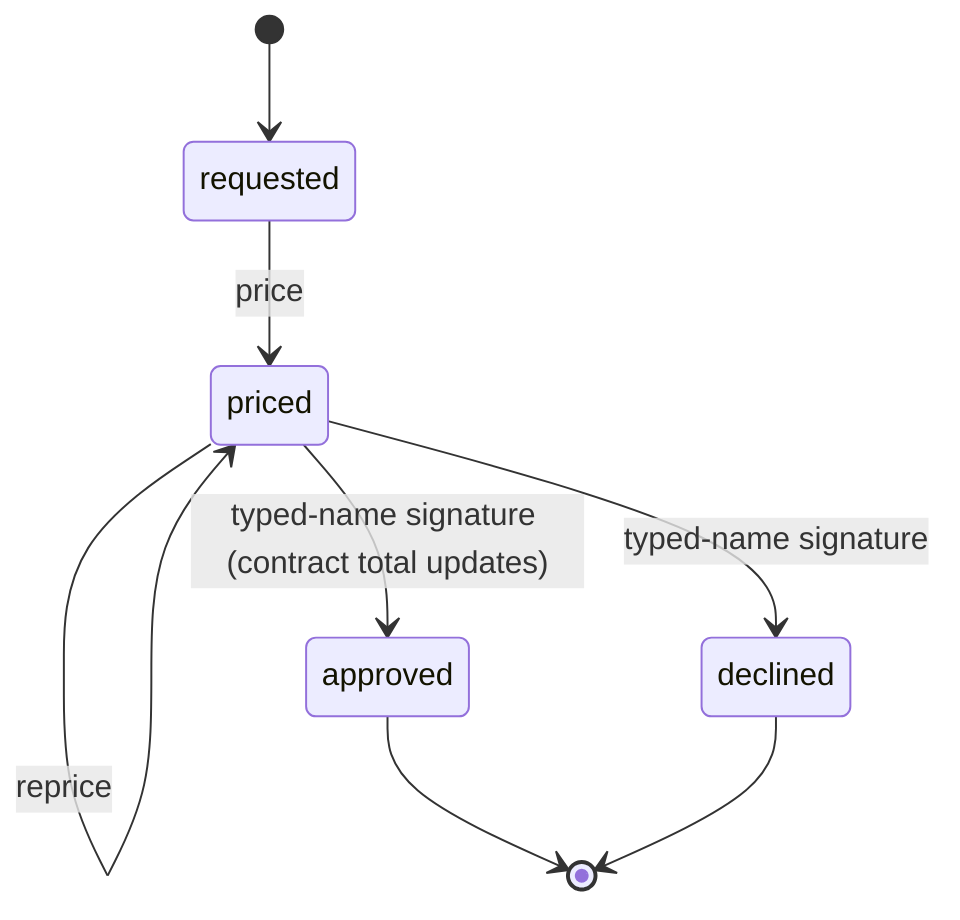

# change-order-tracker

**The problem:** on a remodel, the customer asks for something extra mid-job. It gets agreed out loud, priced later, and argued about at the final invoice.

**Who it is for:** a small contractor or service company that wants every change written down, priced and signed before the work goes ahead.

**What it does:** a small web app and API that takes each change order from request, to price, to a customer signature, and keeps a record nobody can quietly edit afterwards.

- Anyone on the job logs a change. It gets the next CO number for that project.
- The office prices it with line items. Credits are allowed. The price can change until the customer decides.
- The customer approves or declines by typing their full name. An approval only goes through for the exact total they were shown.
- The contract total moves only when the customer approves, never on a request or a quote.
- Every step lands in an audit trail that both the app and the database refuse to edit or delete.

This is a working reference build with invented data. It has tests and a runnable demo, and it has not been deployed for a real customer (see [Limitations](#limitations)).

## What you will see

`npm run demo` starts the real API on a local port and walks one fake kitchen job through the whole flow. Lines below are copied from that run (full capture in [demo/output.txt](demo/output.txt)):

```
3. Someone else tries to sign for the customer
   HTTP 422: typed name does not match the customer name on the project

4. Office reprices; customer tries to approve the old price they were shown
   new total $610.00
   HTTP 409: the price changed since it was shown; reload and review before approving

5. Customer approves the current price by typing their name
   status=approved
   signature: typed name "Alex Sample", signed at 2030-03-04T14:07:30.000Z, amount $610.00
   contract total after approval: $19,110.00 (base $18,500.00, approved changes $610.00, awaiting approval $0.00)

7. Trying to change an approved change order
   API: HTTP 409: change order is already approved and cannot be repriced
   raw SQL "UPDATE signatures SET typed_name = 'Forged Name'" -> blocked: signature records are immutable
   raw SQL "DELETE FROM audit_events WHERE id = 3" -> blocked: audit trail is append only
```

The dates are a fixed demo clock, so the output is the same on every run.

## How the rules are enforced

- **Money** is stored as integer cents.
- **Signature record**: the typed name (compared to the customer name on the project, ignoring case and extra spaces), a server timestamp, the amount, a SHA-256 hash of the exact terms signed, the IP and the user agent.
- **Contract total**: changed in one code path only (approval), in the same transaction as the signature.
- **Audit trail**: every step appends an event that is hash-chained to the one before it.

The rules that matter are also enforced by SQLite triggers, so they hold against direct SQL as well as the API:

| Attempt | Result |
| --- | --- |
| Update or delete an audit event | blocked |
| Update or delete a signature | blocked |
| Edit a change order or its line items after approve or decline | blocked |
| Mark a change order approved or declined with no signature row for that decision and amount | blocked |
| Insert a change order that starts out priced, approved or declined | blocked |
| Add a signature to a change order that is not priced, or for a different amount | blocked |
| Set a contract total that is not base + approved change orders | blocked |

If someone with raw file access drops the triggers and edits an audit event anyway, `GET /api/audit/verify` recomputes the hash chain and reports the first altered event.

## Architecture





No runtime dependencies: Node's built-in `http`, `sqlite` and `crypto` modules, with TypeScript run directly by Node (type stripping). `typescript` and `@types/node` are dev dependencies used only for type checking.

## Run it

Needs Node 24 or newer.

```
npm install
npm start
```

Open http://localhost:3000 (the server listens on 127.0.0.1 only). The store is in memory and seeded with two fake projects, so it resets on restart. To keep data in a file, set `DB_PATH` before starting; `.env.example` lists the two settings, and the app reads them from the environment, not from a `.env` file:

```
DB_PATH=./data.db npm start                # bash
$env:DB_PATH = "./data.db"; npm start      # PowerShell
```

### API

| Method and path | Purpose |
| --- | --- |
| `GET /api/projects` | list projects |
| `GET /api/projects/:id` | project, totals and change orders |
| `POST /api/projects/:id/change-orders` | request a change: `title`, `description`, `requestedBy` |
| `GET /api/change-orders/:id` | one change order with line items and signature |
| `POST /api/change-orders/:id/price` | `pricedBy`, `lineItems: [{description, quantity, unitPriceCents}]` |
| `POST /api/change-orders/:id/approve` | `typedName`, `expectedTotalCents` (the total the customer was shown) |
| `POST /api/change-orders/:id/decline` | `typedName`, optional `reason` |
| `GET /api/audit?projectId=` | audit events, all projects if `projectId` is left out |
| `GET /api/audit/verify` | recompute the hash chain |

## Tests

```
npm test
```

14 tests using the built-in Node test runner: the lifecycle rules, validation, the database triggers against direct SQL tampering, hash chain tamper detection, and the HTTP API end to end on a random local port. `npm run typecheck` runs the TypeScript compiler in check-only mode. CI (`.github/workflows/ci.yml`) runs typecheck, tests and the demo on Node 24 and 26.

## Demo

```
npm run demo
```

Runs offline, with nothing to configure. It starts the real API on a random local port with an in-memory store and a fixed clock, then walks one fake project through: request, pricing, a signature attempt under the wrong name, a reprice followed by an attempt to approve the stale price, a valid approval, a declined credit, tampering attempts through the API and raw SQL, and the audit trail with its hash chain check. The excerpt near the top of this page comes from this run.

## Background

The pattern comes from how the author runs change orders in small service businesses: capture the change as a record, price it before work proceeds, get the customer's approval in writing, and let the contract value follow the approvals. This repo is a clean-room, small-scale build of that pattern. All names and numbers in it are invented.

## Limitations

- Not deployed anywhere. It has been run locally and in CI only, with invented data, never with a real customer or a real job.
- Nothing is mocked because nothing external is integrated. There is no email or SMS, no payment, no accounting or CRM sync and no PDF output. The customer email on a project is stored and never used; getting the change order in front of the customer is up to you.
- No authentication or roles. `requestedBy` and `pricedBy` are free text, and anyone who can reach the API can call any endpoint, including approve. A real deployment needs logins for staff and a per-customer approval link.
- A typed name is evidence of intent, not identity proof. The name check is case-insensitive text matching against the project record. There is no verification of the signer, and this has not been reviewed against any e-signature law.
- The stale-price check compares totals only. If the scope text or line items change but the total stays the same, the approval still goes through; the signature hash records the terms as they stood at signing.
- The triggers do not cover everything. Direct SQL can still edit a change order or its line items before the customer decides, change the customer name on a project, or insert a signature row with any name on a priced order. The name match and the stale-price check live in the application code.
- Tamper evidence has limits. The hash chain covers audit events only, not the other tables, and it does not notice if the newest events are removed. Someone with full control of the database file could drop the triggers and rewrite the whole chain. Anchoring the latest hash somewhere external would close that gap.
- Approved change orders cannot be voided or reversed. A correction has to be a new change order (for example a credit).
- Quantities are whole numbers and there is no tax, markup or multi-currency handling.
- Single process, synchronous SQLite, no schema migrations (a database file made by an older version keeps its older triggers). Not built for concurrent writers across machines, and not load tested.
- The web page is a plain functional page. The API it calls is tested, but there are no automated browser tests.
- Needs Node 24 or newer for `node:sqlite` and for running TypeScript directly. Tested on Node 24 and 26 only; `node:sqlite` may print an experimental warning on some versions.

License: MIT, see the LICENSE file.
